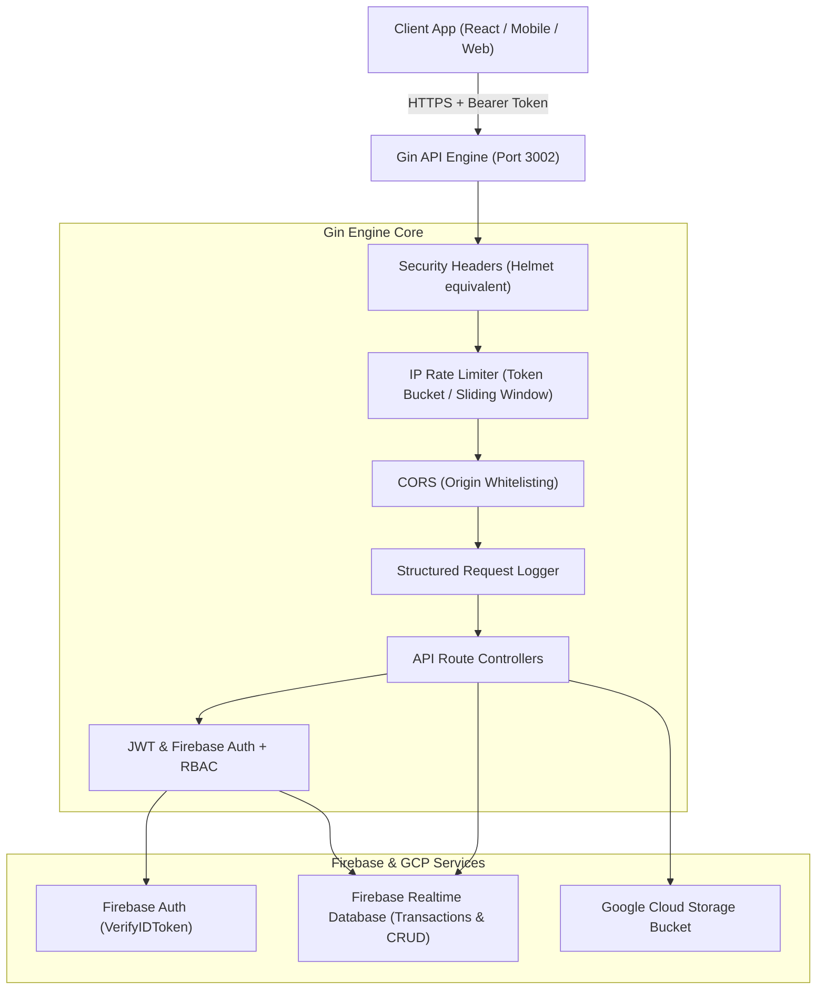

# Forged In Frames - Go Backend API

High-performance, idiomatic Go REST API for **Forged In Frames**, rewritten from the original Node.js/Express backend. Built with **Gin**, the official **Firebase Admin Go SDK** (`firebase.google.com/go/v4`), **Google Cloud Storage**, and **Google OAuth 2.0**.

---

## Architecture & Tech Stack

- **Runtime & Language**: Go 1.24+ (Compiled static binary, zero runtime dependency)
- **Web Framework**: [Gin](https://github.com/gin-gonic/gin)
- **Database & Auth**: [Firebase Admin Go SDK](https://firebase.google.com/docs/admin/setup#go) (`firebase.google.com/go/v4`)
  - Firebase Authentication (`auth.Client`)
  - Firebase Realtime Database (`db.Client` with atomic transactions)
  - Firebase Cloud Storage via Google Cloud Storage (`cloud.google.com/go/storage`)
- **Authentication**: Google OAuth 2.0 (`golang.org/x/oauth2`) + HMAC-SHA256 JWT (`golang-jwt/jwt/v5`) with Firebase ID Token fallback
- **Security**: Security Headers (CSP, HSTS, X-Content-Type-Options, X-Frame-Options), strict CORS, in-memory IP Rate Limiting, path sanitization, and script-tag injection guards



---

## Directory Structure

```
forgedinframes-backend-go/
├── cmd/
│   └── api/
│       └── main.go           # Application entry point, router & graceful shutdown
├── config/
│   └── config.go             # Environment parsing, defaults, admin emails
├── internal/
│   ├── firebase/
│   │   └── client.go         # Firebase app, Auth client, RTDB client, Storage bucket
│   ├── middleware/
│   │   ├── auth.go           # Bearer token verification (JWT + Firebase ID token fallback), RBAC
│   │   ├── cors.go           # CORS configuration
│   │   ├── ratelimit.go      # IP rate limiter (in-memory sliding window)
│   │   ├── security.go       # Security headers (CSP, HSTS, frame options, etc.)
│   │   └── logger.go         # Structured request logging
│   ├── models/
│   │   └── models.go         # Domain models, request/response DTOs, validations
│   └── handlers/
│       ├── auth.go           # /api/auth (Google OAuth redirect, callback, /me, /logout)
│       ├── photos.go         # /api/photos (categories, photocontainer, likes, thumbnails)
│       ├── blogs.go          # /api/blogs (CRUD, comments)
│       ├── storage.go        # /api/storage (upload photo to GCS, delete photo)
│       ├── users.go          # /api/users (get/sync user profile)
│       └── health.go         # /health, /api/health with system diagnostics
├── .env.example
├── .gitignore
├── Dockerfile
├── go.mod
├── go.sum
└── README.md
```

---

## API Endpoints (Parity with Node.js)

### Health
- `GET /health` & `GET /api/health` - Health status, uptime, runtime memory stats, and Firebase connection details.

### Authentication (`/api/auth`)
- `GET /api/auth/google` - Initiates Google OAuth consent flow.
- `GET /api/auth/google/callback` - OAuth callback, exchanges code, upserts user in RTDB, and returns app JWT.
- `GET /api/auth/me` - Authenticated profile & RBAC lookup.
- `POST /api/auth/logout` - Session logout.

### Photos & Portfolio (`/api/photos`)
- `GET /api/photos/categories/routes` (Alias: `/getcategoryRoutes`)
- `GET /api/photos` (Alias: `/photocontainer`) - Filter by `?type=`
- `GET /api/photos/photocontainer/:type`
- `POST /api/photos/photocontainer/:categoryName` - (Protected) Add category & route
- `PUT /api/photos/photocontainer/updatecategory/:categoryName` - (Protected) Update category metadata
- `PUT /api/photos/photocontainer/:categoryName/changevisibility/:visibility` - (Protected) Toggle visibility
- `PATCH /api/photos/photocontainer/:type/updatephoto/:uid` - (Protected) Update image details
- `DELETE /api/photos/photocontainer/:type/deletephoto/:uid` - (Protected) Remove image
- `POST /api/photos/photocontainer/:type/likephoto/:uid` - (Protected) Atomic transaction toggle for likes
- `PATCH /api/photos/photocontainer/:type/makecategorythumbnail` - (Protected) Update category thumbnail

### Blogs & Comments (`/api/blogs`)
- `GET /api/blogs` (Alias: `/getblogs`)
- `GET /api/blogs/:blogpost`
- `POST /api/blogs` (Alias: `/addblog`) - (Protected) Create blog post
- `PUT /api/blogs/:blogpost` (Alias: `/updateblog/:blogpost`) - (Protected) Update blog post
- `DELETE /api/blogs/:blogpost` (Alias: `/deleteblog/:blogpost`) - (Protected) Delete blog post
- `GET /api/blogs/:blogpost/comments` (Alias: `/getcomments/:blogpost`)
- `POST /api/blogs/:blogpost/comments` (Alias: `/addcomment`) - (Protected) Post comment
- `DELETE /api/blogs/:blogpost/comments/:key` (Alias: `/deletecomment/:key`) - (Protected) Author/Admin delete comment

### Storage & Uploads (`/api/storage` & `/api/upload`)
- `POST /api/storage/` (Alias: `/uploadphoto`) - (Protected) Multipart image upload directly to GCS
- `DELETE /api/storage/files/:fileName` (Alias: `/deletephoto`) - (Protected) Delete image from GCS

### Users (`/api/users`)
- `POST /api/users/:uid` - (Protected) Sync/upsert user profile with atomic RBAC check
- `GET /api/users/:uid` - (Protected) Get user profile

---

## Configuration

Copy `.env.example` to `.env.dev` or `.env.prod`:

```bash
cp .env.example .env
```

Ensure your Firebase service account JSON file is placed in this directory (or configured in `FIREBASE_SERVICE_ACCOUNT_KEY` / `FIREBASE_SERVICE_ACCOUNT_PATH`).

---

## Running Locally

```bash
# Run directly
go run ./cmd/api

# Build binary
go build -o bin/server.exe ./cmd/api
./bin/server.exe
```

---

## Docker Deployment

Build and run using the optimized multi-stage Dockerfile:

```bash
docker build -t forgedinframes-backend-go .
docker run -p 3002:3002 --env-file .env forgedinframes-backend-go
```
